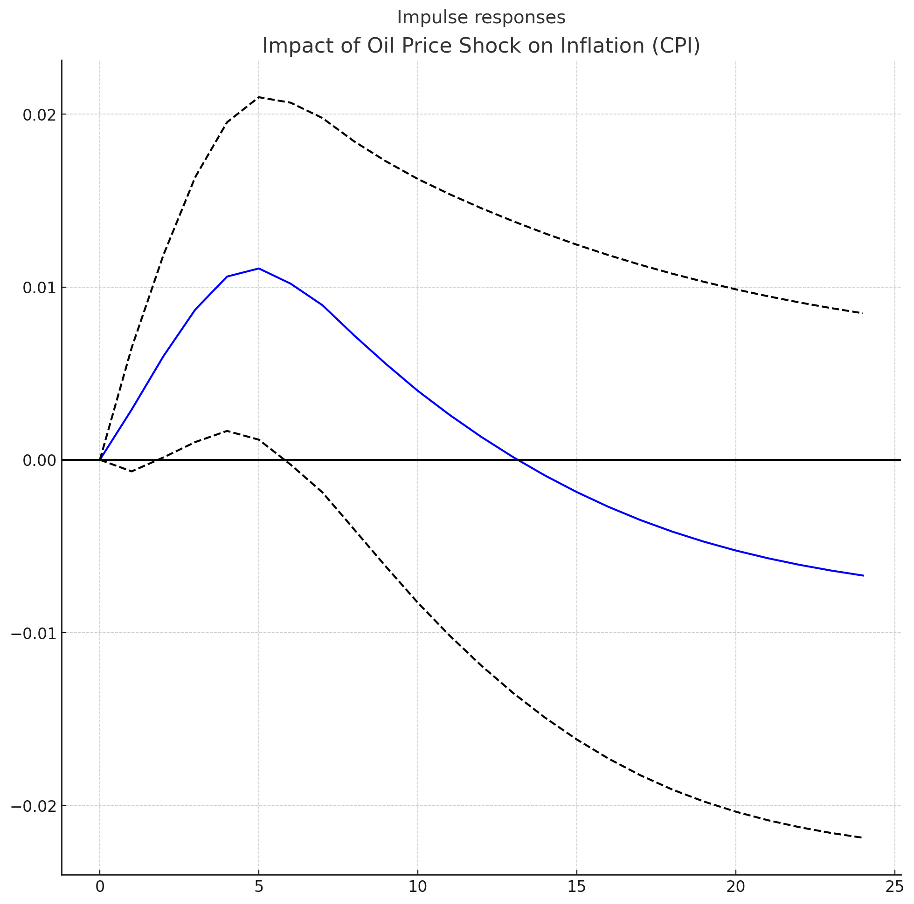

# Oil Price Shocks & US Inflation Forecasts — ARIMA / VAR in R

> How do oil price shocks affect short-run US inflation forecasts — and does the *frequency* of the data change the answer? A time-series study (R, ARIMA + VAR, impulse response functions) of CPI inflation, oil prices, GDP, unemployment, and inflation expectations.

## Research question

> How do oil price shocks impact short-run inflation forecasts in high-frequency data, and how well do ARIMA and VAR models capture these effects?

## Approach

- **ARIMA** — univariate benchmark: forecasts inflation from its own history
- **VAR** — multivariate dynamics between inflation, oil prices, GDP, unemployment, and inflation expectations, with **impulse response functions** for oil-price and GDP shocks (`assets/`)
- **Forecast accuracy** compared across both models (paper, Tables/Figures: ARIMA coefficients, VAR estimates, forecast-vs-actual, accuracy measures)

## The data-frequency problem (the paper's real contribution)

The series arrive at different frequencies, and aligning them is a modelling choice, not a clerical step:

| Series | Native frequency | Treatment |
|---|---|---|
| CPI inflation | Monthly (from 1965) | As-is |
| Oil prices | Daily | Averaged to monthly — smooths spikes, keeps direction |
| GDP | Quarterly | Interpolated to monthly |
| Inflation expectations | Monthly / quarterly | Harmonized to monthly |

Data: `data/monthly_macro_dataset_1986.csv` (monthly, Jan 1986 onward: unemployment, oil, CPI, GDP, inflation expectations) and `data/cpi_inflation_monthly_1965.csv`. Sources: BLS, FRED, and other government / international agencies (documented in the proposal, `docs/`).

## Contents

- `reports/Oil_Shocks_US_Inflation_Forecasts_Paper.docx` — the full paper (Farooq, Umer — Rutgers MPI, Oct 2024), including the R estimation code appendix (`vars` package IRFs)
- `reports/Oil_Shocks_Inflation_Presentation.pptx` — the presentation version
- `docs/Paper_Proposal_and_Data_Plan.docx` — research design and data-collection strategy
- `assets/` — impulse response charts: oil shock → inflation, GDP shock → inflation

## Author

**Umer Farooq** — Economic & Climate Risk Analyst · [LinkedIn](https://www.linkedin.com/in/umer-farooq-gojra/) · [GitHub](https://github.com/umerfarooq7424)

## License

MIT — see LICENSE. Data: public sources (BLS / FRED).
